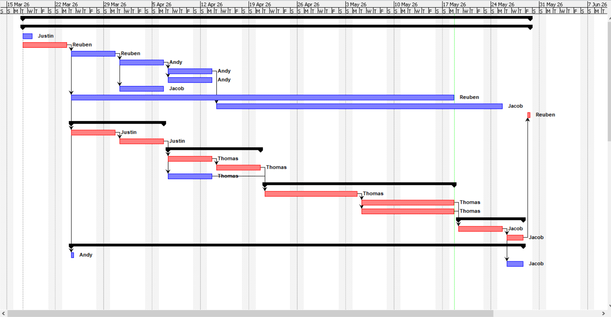
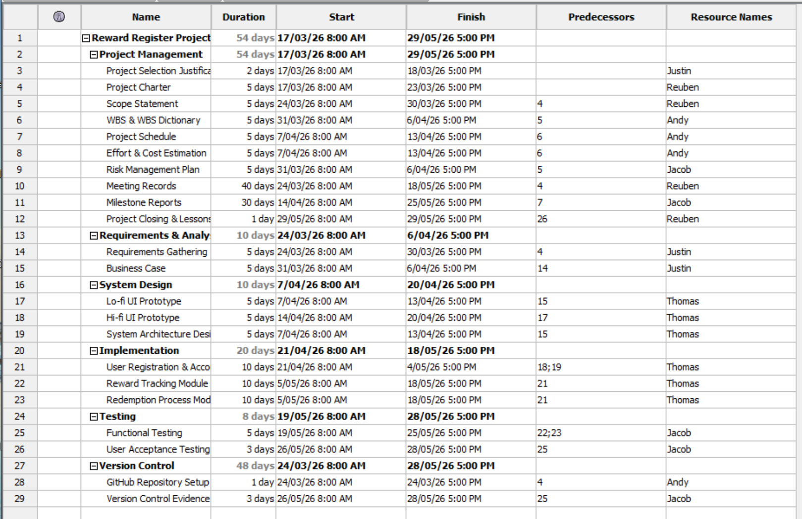
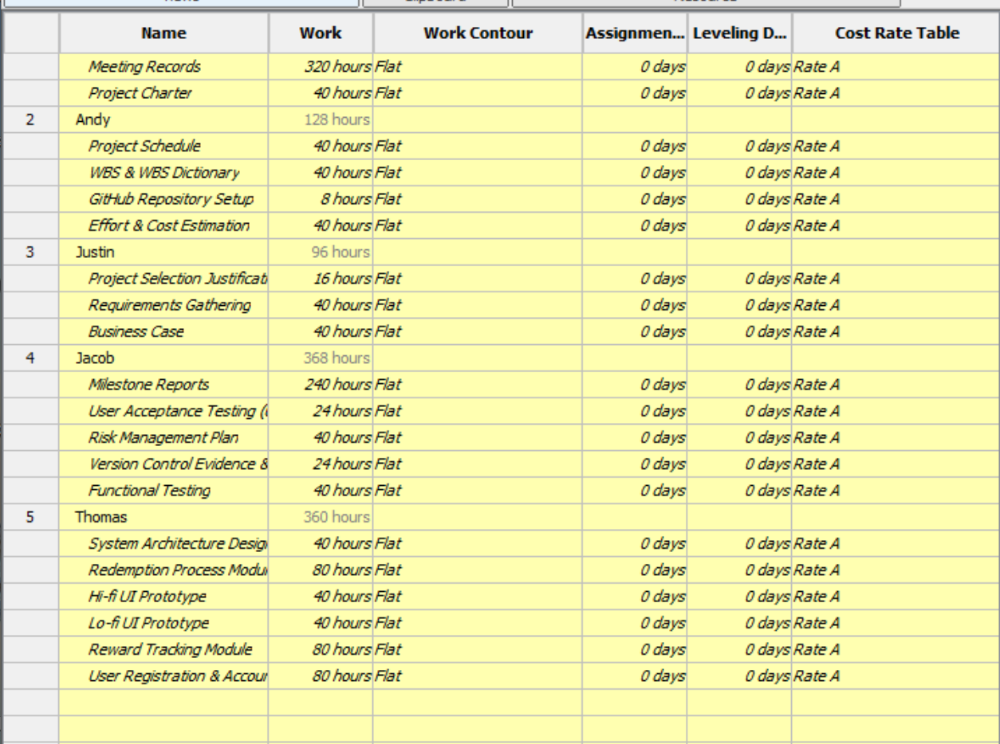
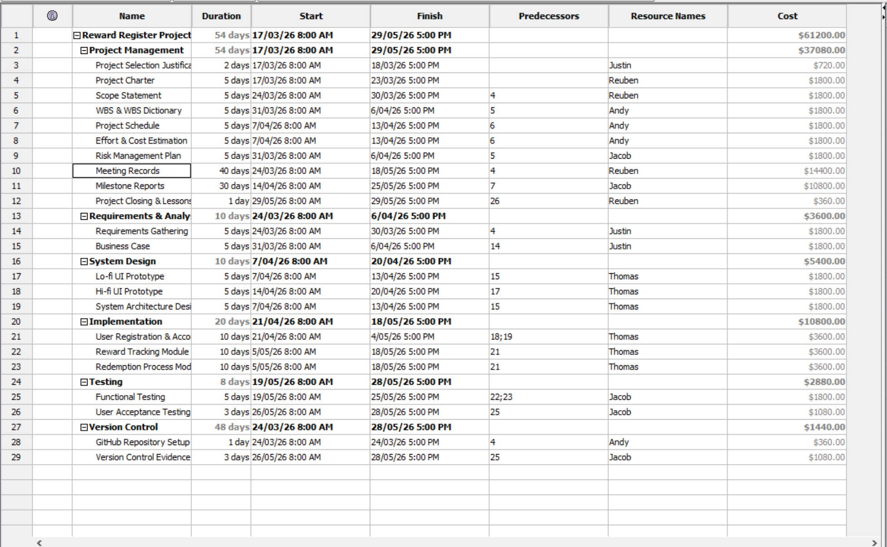
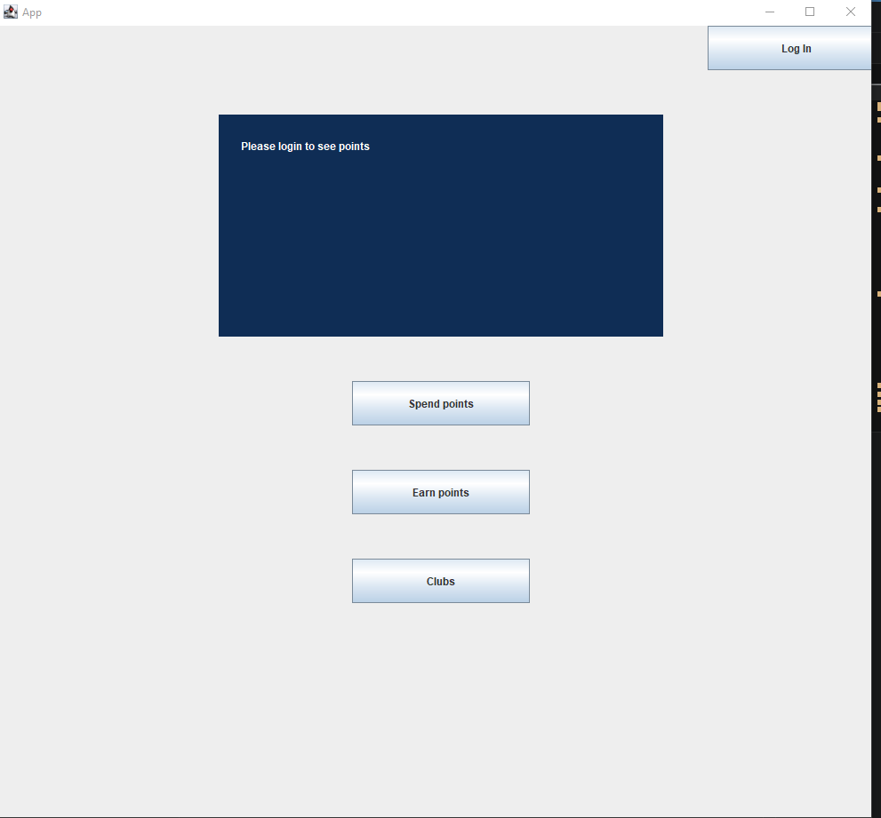
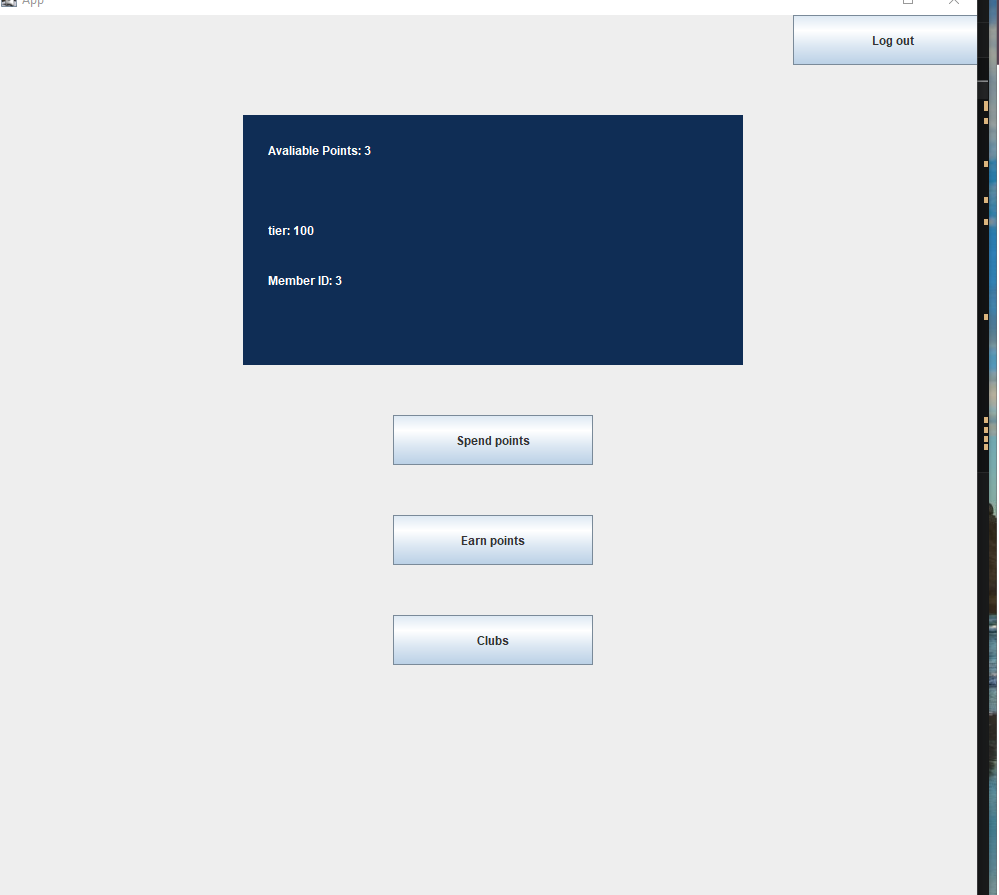
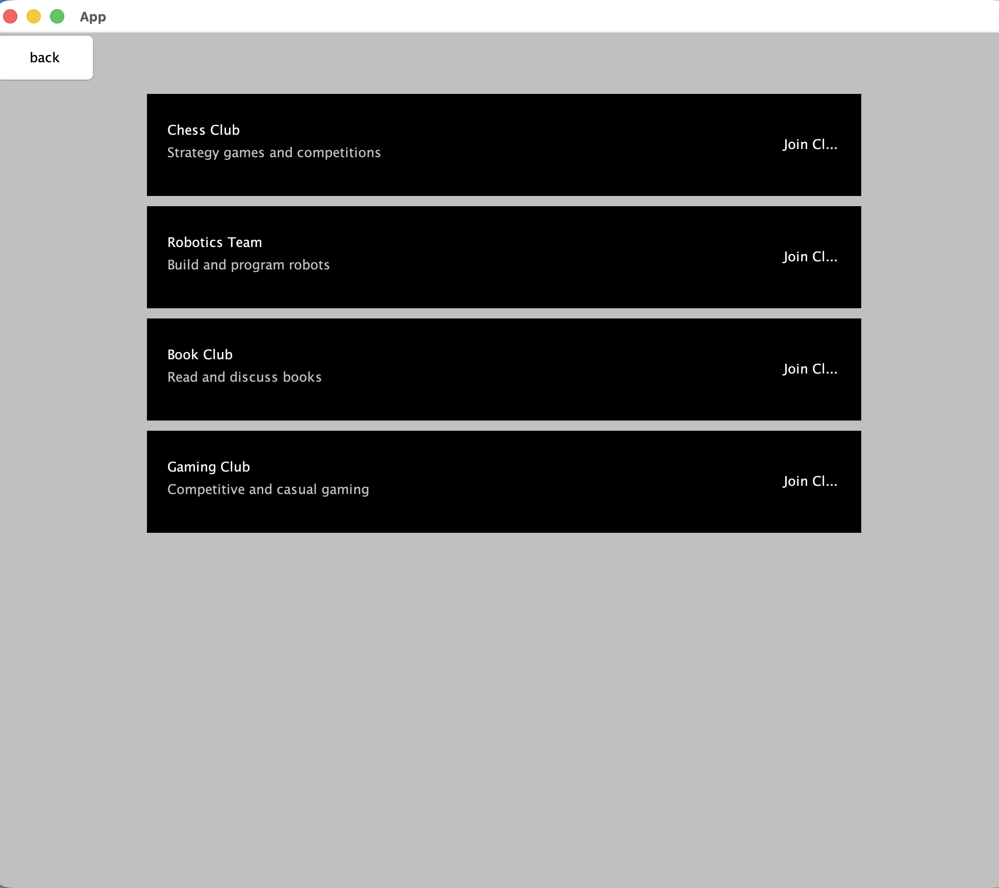
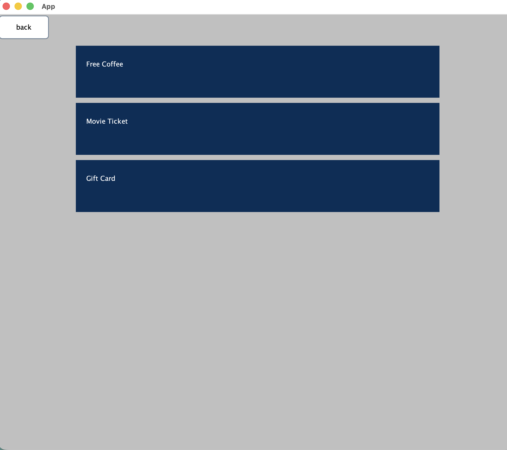

# Reward Register: IT Project Management Case Study


The planning artefacts behind **Reward Register**, a loyalty-points system for the fictional airline FlyDreamAir.
Members earn points, redeem rewards, track their status tier and join partner clubs.
It was a five-person team project for **CSIT214 IT Project Management** at the University of Wollongong (Autumn 2026),
run over 11 weeks from project selection to closure.

> This repository covers the project-management side: work breakdown, schedule, resources, cost and effort.
> The Java Swing UI prototype was built by the team's product lead; screenshots are below.

## My role: Planning Lead

- Wrote the **Work Breakdown Structure and WBS dictionary**.
- Built the **project schedule in ProjectLibre**, an open-source alternative to MS Project:
  29 tasks in 6 phases over 54 working days, with task dependencies, a Gantt chart, resource allocation and a cost table
  ([`reward-register.pod`](docs/schedule/reward-register.pod)).
- Produced the **effort and cost estimate** with IFPUG Function Point Analysis and COCOMO II (Early Design).
- Set up the team's GitHub repository, with one issue per task and ticket-prefixed commit messages.

## Effort and cost estimate

| Step | Result |
|---|---|
| Unadjusted function points (EI 15 + EO 21 + EQ 10 + ILF 35 + EIF 7) | 88 UFP |
| Value adjustment factor (14 general system characteristics, TDI = 36) | 1.01 |
| Adjusted function points | 89 AFP |
| Size, at 53 SLOC per function point (web scripting benchmark) | ≈ 4,717 SLOC |
| COCOMO II nominal effort | 15.85 person-months |
| Effort after cost drivers (EM = 0.85) | 13.47 person-months ≈ 2,155 hours |
| **Estimated cost** at AUD $45/hour | **AUD $96,975** |
| Estimated duration at 5 staff × 10 hours/week | ≈ 43 weeks |

## Schedule



<details>
<summary>Task table, resource allocation and cost views</summary>





</details>

## Prototype

<details>
<summary>Screenshots of the UI prototype (built by the product lead)</summary>

| Start | Member dashboard |
|---|---|
|  |  |
| **Clubs** | **Spend points** |
|  |  |

</details>

## Team

Jacob Cassim · Junyi (Justin) Wang · Lachlan Williams · Reuben Kruger · Zihua (Andy) Zeng

## Repository layout

```text
docs/schedule/    ProjectLibre file and exported views (Gantt, tasks, resources, cost)
docs/prototype/   screenshots of the UI prototype
```

To open the schedule, install [ProjectLibre](https://www.projectlibre.com/) and open `docs/schedule/reward-register.pod`.
